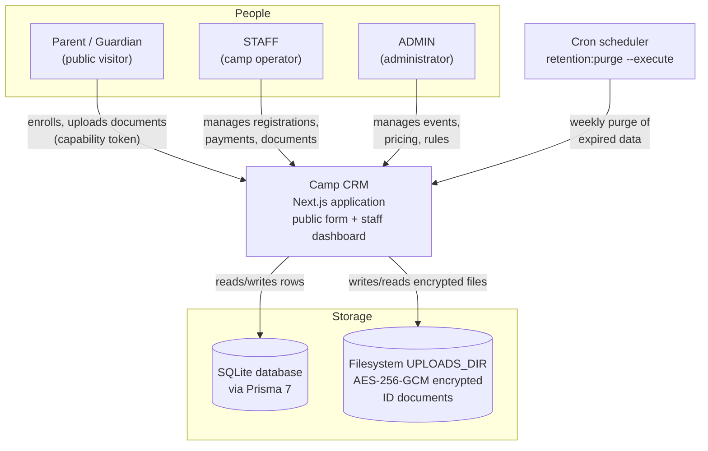

# Camp CRM — Project Overview

**Version:** 1.0 · **Generated:** 2026-09-11 · **Scope:** `camp-crm` repository (Next.js 16 + Prisma 7 + SQLite)

## What this project is

Camp CRM is a self-contained web application that digitizes the entire enrollment back-office of a summer camp. Before this system, running enrollment meant paper forms, spreadsheet tallies, ID card photos scattered through chat apps, and a cash notebook — with no reliable record of *who agreed to what*, no protection against overbooking the camp, and identity documents lying around readable on someone's disk. Camp CRM replaces all of that with a single service: parents enroll through a public form, staff manage registrations and money from a dashboard, documents are encrypted before they ever touch a disk, and expired data deletes itself.

The application is intentionally a **modular monolith** — one Next.js process, one embedded SQLite file, one directory of encrypted uploads. There is no database server to operate, no queue, no third-party API to pay for. For a small camp organization with a handful of staff and a few hundred families per season, that is the whole point: the system is simple enough to be run by non-engineers, yet it enforces the compliance and security discipline (GDPR consent trails, encrypted-at-rest documents, role separation) that paper workflows never could.

Everything is in Italian on the user-facing side (`formatEuro`, error messages, the privacy notice), reflecting its single-organization, European deployment target; the code itself is TypeScript throughout.

## What it can do

The system's capabilities follow the life of an enrollment, from the parent's first click to the day the data is lawfully destroyed.

**Public enrollment with live capacity** — anyone with the link fills `/registrazioni/nuova` (`src/app/registrazioni/nuova/page.tsx`): picks an event, sees prices and remaining seats, adds campers (each with a mandatory ID document), accepts privacy and camp rules, and submits. The server re-validates everything and uses a database transaction so two simultaneous families can never claim the last seats (`src/app/api/registrazioni/route.ts`).

**Capability-token document upload** — because parents have no accounts, the enrollment response carries a one-time 256-bit `uploadToken`; the browser immediately uploads each participant's ID document with it. Staff can do the same from the detail page using their session instead.

**Encrypted document filing cabinet** — every identity document is encrypted in the application with AES-256-GCM before being written under `UPLOADS_DIR/participants/<id>/` (`src/lib/uploads.ts`, `src/lib/document-crypto.ts`). A stolen disk or backup yields nothing readable without the key — which lives outside the data volume and fails closed if missing.

**Staff dashboard for registrations and money** — a role-aware workspace: STAFF confirm registrations, edit participants, record payments (cash / bank transfer / card, plus `SCONTO` discounts that reduce the balance without counting as received cash). ADMIN additionally manages events themselves. Balances are always recomputed from first principles by one shared function, `computeRegistrationBalance` (`src/lib/pricing.ts`), so the numbers on the dashboard, the lists and the detail page can never disagree.

**GDPR by construction** — consent is captured with a timestamp and policy version, the public `/privacy` page renders the art. 13 notice from configuration, and a cron-friendly script (`scripts/purge-expired-registrations.ts`) deletes registrations whose event ended more than `RETENTION_MONTHS` ago — including their encrypted files.

## C4 Context — the system in one picture

The diagram below shows Camp CRM's entire external world: three kinds of human actors and two dependencies (an embedded database and a local filesystem). The absence of clouds, queues and third-party APIs *is* the architecture story.

Two decisions are visible immediately: the only non-human trigger is the retention cron, and the document store sits next to the database as an equal first-class dependency — files, not just rows, are part of the system's duties.

## Why this tech stack

The stack reads like a checklist of "boring technology chosen on purpose". Next.js 16 with the App Router lets the same process serve the public form, the staff UI and the JSON API, with React Server Components keeping personal data on the server (pages query Prisma directly — there is no public read API to protect). Prisma 7 over SQLite via the `better-sqlite3` adapter gives typed models, real transactions and zero-operations persistence in one file. Auth.js (next-auth v5) with a credentials provider and JWT sessions adds login without an external identity provider, carrying the `role` claim that powers the ADMIN/STAFF split. Tailwind CSS 4 keeps the UI small; Node's built-in `crypto` provides AES-256-GCM without any KMS dependency.

| Area | Choice | Why this and not something else |
|---|---|---|
| Framework | Next.js 16.2.6, App Router, standalone output (`next.config.ts`) | One deployable process for pages + API; standalone output keeps the Docker image lean; RSC reads shrink both attack surface and client JS |
| Database | SQLite via Prisma 7 + `@prisma/adapter-better-sqlite3` (`src/lib/prisma.ts`) | Zero-ops embedded store sized for one camp; transactions + SQLite's single-writer serialization are *exploited* for capacity safety; the adapter keeps `libsql` as a documented alternative |
| Auth | next-auth v5 (Auth.js), credentials + JWT (`src/auth.ts`) | No IdP wanted; role rides in the signed token (`src/types/next-auth.d.ts`); bcrypt (cost 12) for passwords |
| Documents | App-level AES-256-GCM envelopes (`src/lib/document-crypto.ts`) | Protection survives disk theft *and* backup leakage; a versioned envelope (magic `CCLE`, `keyId`) anticipates key rotation without a KMS |
| Uploads in browser | XMLHttpRequest (`src/lib/uploads-client.ts`) | `fetch` cannot report upload progress; the XHR `onprogress` event powers the progress bar parents see |
| UI | React 19, Tailwind CSS 4, it-IT locale | Small team, single-tenant product, utility CSS keeps the styling surface tiny |

## What it does — and deliberately does not

**In scope.** Public enrollment with mandatory consent; per-event capacity limits with overbooking protection; tiered sibling pricing and balance tracking; encrypted ID document storage with staff management; JWT-based RBAC (ADMIN/STAFF); GDPR consent provenance, a public privacy notice, automated retention purge and orphan-free deletion.

**Out of scope.** Online payment processing (no gateway — money is *recorded*, not charged); email or SMS notifications (the thank-you page's "you'll receive a confirmation" is aspirational copy, and the README lists e-mail among the gaps); self-service data-subject tools (no export/erasure UI — requests are handled manually); audit logging (explicitly "not yet implemented"); and dedicated handling of special-category health notes, which the README flags as an open legal question around the `Participant.notes` field. These omissions are documented trade-offs, not oversights — each one keeps the system operable by a tiny organization without a support team behind it.
