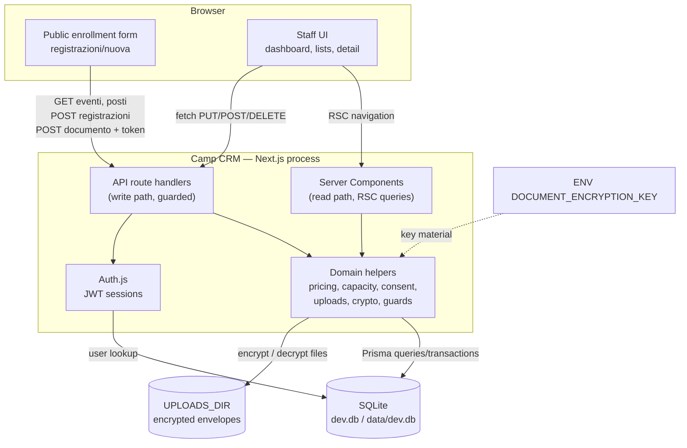
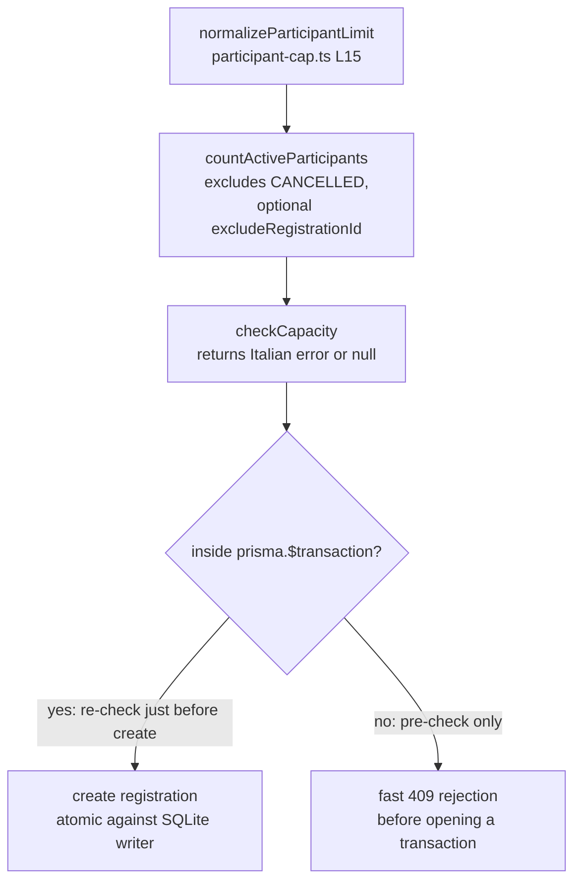
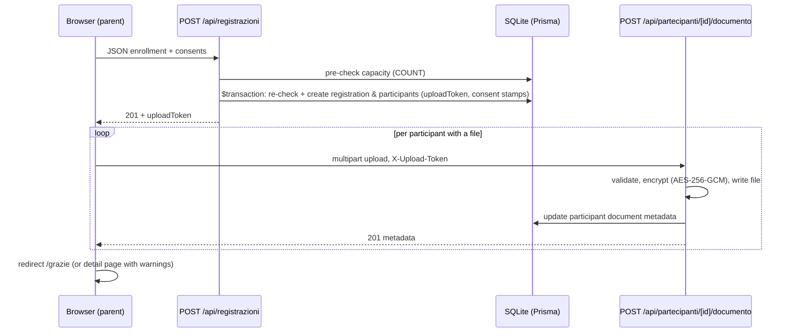
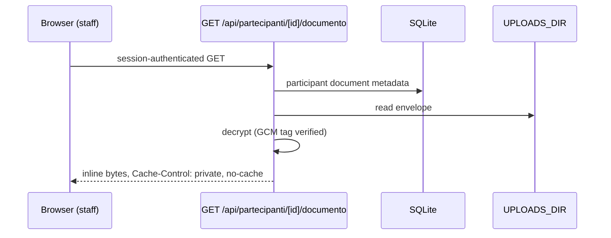

# System Architecture — Camp CRM

**Version:** 1.0 · **Classification:** internal architecture documentation · **Generated:** 2026-09-11

---

## 1. Architecture Overview

### 1.1 Design philosophy

Camp CRM is a **modular monolith organized in vertical slices**, wrapped around an embedded database. There is no service mesh to reason about and no network hop between "backend" and "database" — the interesting complexity lives in domain rules (capacity, pricing, consent, crypto), and the architecture is shaped to keep those rules in one place, pure and testable, while the surrounding web plumbing stays thin.

Three principles, each visible in the code, define the system:

**1. Vertical slices over technical layers.** Each business area owns everything about itself: `src/app/registrazioni/` (pages) sits beside `src/app/api/registrazioni/` (HTTP handlers), and whatever is reusable across slices is extracted *downward* into pure helpers in `src/lib/` (`pricing.ts`, `participant-cap.ts`, `document-crypto.ts`, `consent.ts`). You can understand a feature by reading one folder plus a lib file — there is no controller/service/repository tripod to climb.

**2. Thin controllers, fat pure functions.** Route handlers do exactly four things — guard, validate, call Prisma, return JSON (e.g. `src/app/api/pagamenti/route.ts` is 47 lines total). All the actual business semantics (what counts as "paid", how kid discounts cascade, whether a cancelled registration frees seats) live in `src/lib/` functions with no framework imports. This is why the same balance calculation can render identically on the dashboard, the list filters and the detail page.

**3. Public write, private read — with one capability bridge.** Anyone may *create* an enrollment; only authenticated staff may *read* anything. The single exception (document upload from the public form) is bridged by an opaque capability token minted at enrollment time and compared in constant time (`tokensMatch`, `src/app/api/partecipanti/[id]/documento/route.ts`). The result is a system where the dangerous direction — data *leaving* — is always session-guarded.

### 1.2 Core architectural patterns

| Pattern | How it is realized here | What it buys |
|---|---|---|
| Modular monolith (vertical slices) | `src/app/<area>/` + `src/app/api/<area>/` + shared pure helpers in `src/lib/` | One deployable; features stay locally readable; no cross-service contracts to version |
| Pragmatic CQRS | Pages read via React Server Components querying Prisma directly (`src/app/registrazioni/page.tsx`); writes go through `/api/*` route handlers | Reads are cheap server renders with no public API surface; writes funnel through one validated, guarded path |
| Aggregate (DDD) | `Registration` is the aggregate root; `Participant`/`Payment` cascade with it; `purgeRegistrationData()` treats rows *and files* as one unit | Invariants (capacity, consent, no orphan files) enforced at aggregate boundaries |
| Capability-based security | 256-bit `uploadToken` returned only to the enrollment creator; constant-time compare | Unauthenticated parents can complete the flow without accounts, without opening a public write hole |
| Defense in depth | Client validation mirrored server-side; capacity checked pre-POST *and* re-checked inside the DB transaction; consents checked twice | UX stays fast while the server remains the authority |
| Versioned envelope encryption | Magic `CCLE` + version + keyId + nonce + GCM tag (`src/lib/document-crypto.ts`) | Confidentiality + tamper detection at rest, with a path to key rotation |

### 1.3 Technology stack

The stack was chosen for operability by a small organization first, elegance second. SQLite means the "database administrator" is a file-copy backup; Next.js standalone means the deployment artifact is one container; Auth.js means there is no identity vendor.

| Layer | Technology | Notes |
|---|---|---|
| Runtime | Node 22 (Docker `node:22-slim`), TypeScript 5 | `better-sqlite3` marked `serverExternalPackages` (`next.config.ts`) so the native module isn't bundled |
| Web framework | Next.js 16.2.6 App Router, React 19, `output: "standalone"` | Pages = RSC queries; API = route handlers |
| Data | Prisma 7 client (generated to `src/generated/prisma`) + `@prisma/adapter-better-sqlite3` (`src/lib/prisma.ts`, singleton on `globalThis` in dev) | 5 models, 8 migrations |
| Auth | next-auth v5 beta, credentials provider, JWT sessions, bcryptjs cost 12 | Role (`ADMIN`/`STAFF`) embedded in token |
| Crypto | Node built-in `crypto`, AES-256-GCM | Key from `DOCUMENT_ENCRYPTION_KEY` (32-byte base64), fail-closed |
| Styling | Tailwind CSS 4 | Utility classes only, it-IT copy |
| Ops | Docker multi-stage, `docker-entrypoint.sh` (migrate deploy → seed → start), cron for retention | Compose wires `camp-data` volume and optional upload disk |

---

## 2. System context (C4 Level 1)

Camp CRM serves three human roles and touches exactly two systems — both of them local. See `1.Overview.md` for the annotated context diagram; the short version: parents hit the public form, staff and admins share the dashboard with different permissions, a cron triggers the retention purge, and everything persists to one SQLite file plus one encrypted-files directory.

---

## 3. Container view (C4 Level 2)

Even in a monolith it is worth naming the containers *inside* the single process, because they have different security postures and lifecycles.

Reading the picture: the browser never talks to the database, and only one of the two persistence stores is relational. The domain-helpers layer is the *only* code that touches Prisma or the filesystem, which is what makes the guards in the API layer meaningful.

### 3.1 Domain modules and responsibilities

| Module | Paths | Responsibility | Key abstractions |
|---|---|---|---|
| Registration Management | `src/app/registrazioni/**`, `src/app/api/registrazioni/**`, `src/lib/registration-cleanup.ts` | Enrollment aggregate: public creation, staff editing, status, deep delete | `Registration`, `uploadToken`, `purgeRegistrationData()` |
| Event Management | `src/app/eventi/**`, `src/app/api/eventi/**`, `src/lib/participant-cap.ts` | ADMIN-owned events; tiered prices; rules; capacity semantics | `participantLimit`, `countActiveParticipants()`, `checkCapacity()` |
| Document Handling | `src/app/api/partecipanti/[id]/documento/route.ts`, `src/lib/uploads.ts`, `src/lib/document-crypto.ts`, `src/lib/uploads-client.ts` | Encrypted ID documents: validate, encrypt, serve, delete | envelope `CCLE`, `saveDocument()`, `readDocument()` |
| Payments & Pricing | `src/app/pagamenti/**`, `src/app/api/pagamenti/route.ts`, `src/lib/pricing.ts` | Money recording + the single balance function | `computeRegistrationBalance()`, `DISCOUNT_METHOD` |
| Authentication & RBAC | `src/auth.ts`, `src/lib/auth-guard.ts`, `src/types/next-auth.d.ts` | Login, JWT sessions with role, page/API guards | `requireRole()`, `assertRole()`, `Role` |
| Privacy & GDPR | `src/lib/consent.ts`, `src/app/privacy/`, `scripts/purge-expired-registrations.ts` | Consent provenance, notice parameters, retention enforcement | `CURRENT_PRIVACY_POLICY_VERSION`, `retentionMonths()` |
| Shared UI shell | `src/app/layout.tsx`, `src/app/page.tsx`, `src/components/Navbar.tsx` | Session-aware navigation; public landing vs staff dashboard | — |
| Ops & Deployment | `Dockerfile`, `docker-compose.yml`, `docker-entrypoint.sh`, `prisma/seed.ts` | Container lifecycle, boot migrations, baseline users | — |

Deep dives for each module live in `4.Deep-Exploration/`.

---

## 4. Component view (C4 Level 3, highlights)

### 4.1 The capacity safety net (Event + Registration)

Capacity is a cross-module invariant, so it deserves its own component sketch. The same three primitives are used by public enrollment, staff edits and the availability widget — with the transactional re-check being the part that actually prevents overbooking.

**Components:** `normalizeParticipantLimit` (`src/lib/participant-cap.ts` L15) turns form noise into `null` (unlimited) or a non-negative integer; `countActiveParticipants` (L30) counts ADULT+KID rows over non-cancelled registrations, optionally excluding the registration being replaced; `checkCapacity` (L55) produces user-facing Italian errors. The registration route runs the check twice — cheaply outside the transaction, authoritatively inside it (`src/app/api/registrazioni/route.ts` L74-113) — and the PUT participants path repeats the pattern with exclusion semantics (`registrazioni/[id]/route.ts` L117-146).

### 4.2 The document pipeline (Document Handling)

One component owns the byte-level lifecycle: validation (mime allowlist jpeg/png/webp/pdf, ≤ 10 MB), server-generated UUID filenames, AES-256-GCM encryption, per-participant folders, traversal-proof path resolution (`documentAbsolutePath`, `src/lib/uploads.ts` L121), and constant-time token authorization (`tokensMatch`, route L19). Full details in `4.Deep-Exploration/Document-Handling.md`.

### 4.3 The money projector (Payments & Pricing)

Payments are append-only facts; balances are *projections* recomputed by `computeRegistrationBalance` (`src/lib/pricing.ts` L86) at every read surface. No stored balance can drift because none exists. `SCONTO` payments reduce the balance without counting as cash — a single `if` in the shared function that every screen inherits.

---

## 5. Key flows

### 5.1 Public enrollment (write path)

### 5.2 Staff document viewing (read path)

---

## 6. Technical implementation notes

**Partial updates as a data-integrity tool.** Every PUT handler builds its `data` object only from fields present in the request body (`src/app/api/registrazioni/[id]/route.ts` L48-71; `src/app/api/eventi/[id]/route.ts` L17-45). A status-only save therefore cannot zero out a subscriber's address, and a rules-only save cannot reset prices. The participants array is special-cased: its mere presence in the body triggers full replace *plus* an in-transaction capacity re-check.

**Fail-closed secrets.** `requireDocumentKey()` (`src/lib/document-crypto.ts` L42) throws descriptive errors when `DOCUMENT_ENCRYPTION_KEY` is missing or is not 32 decoded bytes — an upload is never silently written in plaintext. The key is cached after first validation.

**Serialization boundary.** Server components hand *plain JSON rows* (dates as ISO strings) to client filter components (`src/app/registrazioni/page.tsx` L27-53, `src/app/pagamenti/page.tsx` L21-38), because `Date` does not survive the RSC → client-component boundary.

**Concurrency posture.** One Node process, async I/O, SQLite single-writer. The only true race — two families taking the last seats — is closed by check-inside-transaction, which SQLite's write serialization makes effectively atomic. No locks, no queues, no optimistic-version columns are needed anywhere else.

**Performance posture.** List pages load all rows with full `include`s and filter client-side — deliberately simple for camp-scale data (hundreds of rows). Capacity counting is two COUNT queries per enrollment. There is no cache to invalidate because there is almost nothing cached: correctness first.

---

## Appendix: Architecture Decision Records (inferred from code)

**ADR 1 — Embedded SQLite instead of a database server.**
Decision: SQLite file via Prisma + better-sqlite3 adapter. Rejected: hosted Postgres/MySQL. Rationale: single-organization deployment; zero-ops beats distributed features; write serialization is a *feature* for the capacity invariant. Consequence: one writer process; scaling out would require migrating the datasource (the adapter layer keeps `libsql` plausible).

**ADR 2 — Capability token instead of accounts or expiring links.**
Decision: 256-bit `uploadToken` per registration, returned only to the creator, compared with `timingSafeEqual`. Rejected: public accounts (friction for parents), timed upload windows (the previous design, replaced per the comment in `documento/route.ts` L82-86 — tokens don't punish slow parents). Consequence: the token never expires; rotation would be a future hardening step.

**ADR 3 — Application-level encryption instead of an encrypted volume.**
Decision: AES-256-GCM envelopes written by the app, versioned header with keyId. Rejected: relying on disk/volume encryption only. Rationale: backups and volume snapshots leave the machine; app-level crypto protects data everywhere the key isn't. Consequence: key management is now the operator's sacred duty — losing `DOCUMENT_ENCRYPTION_KEY` loses every document (README warns loudly); rotation is designed-for but not yet implemented.

**ADR 4 — Records pages, not APIs.**
Decision: server components query Prisma directly for reads; only writes expose HTTP endpoints. Rejected: a full REST read API + SPA. Rationale: shrinks the public surface to the exact endpoints the enrollment form needs; personal data renders server-side. Consequence: the JSON API is an internal UI API (no versioning, no CORS, no rate limiting) and must not be exposed beyond the origin.

**ADR 5 — Money as floats, balances as projections.**
Decision: `Float` amounts in SQLite; balances always recomputed by `computeRegistrationBalance`. Rejected: decimal columns and stored balance columns. Rationale: camp quotas are small round numbers; recomputation eliminates an entire drift-bug class. Consequence: sub-cent artifacts are theoretically possible; at these magnitudes they are invisible after `formatEuro` rounding.

**ADR 6 — Files live beside the database, not inside it.**
Decision: documents on the filesystem under `UPLOADS_DIR`, metadata in `Participant` rows. Rejected: BLOBs in SQLite. Rationale: bind-mount an external disk without touching DB backups; stream decrypted bytes without DB buffering. Consequence: files must be garbage-collected by application code — hence `purgeRegistrationData()` and the "no orphans" guarantee.
