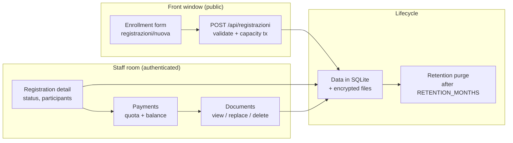
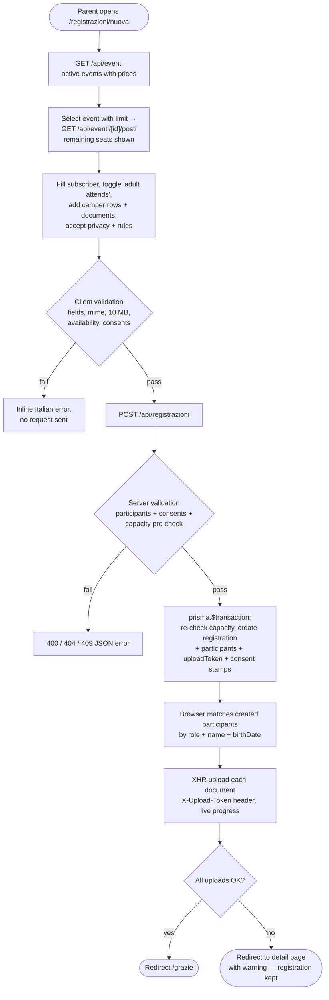
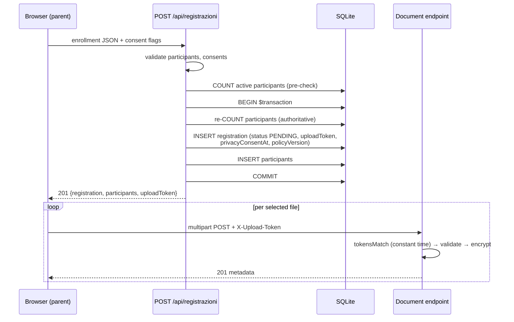
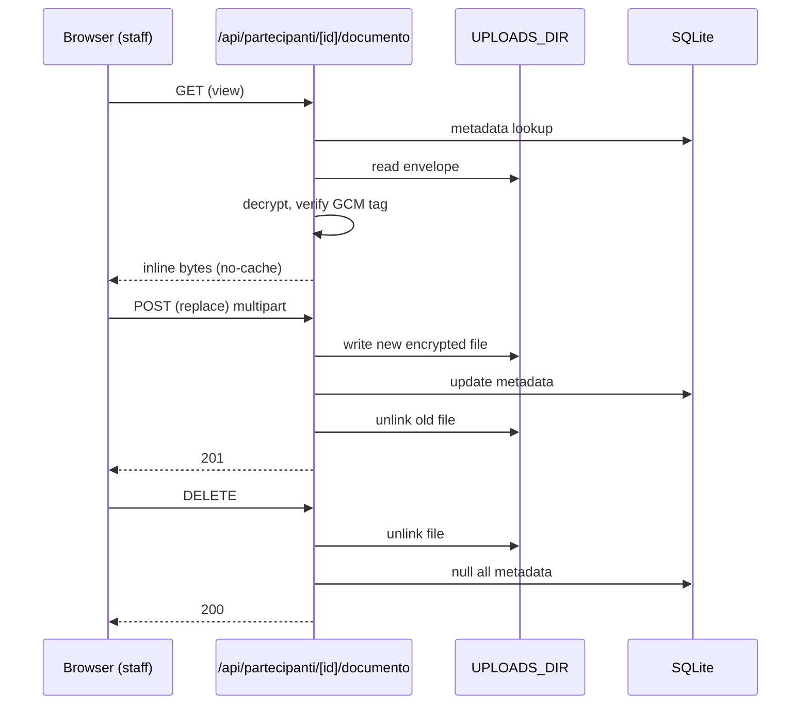
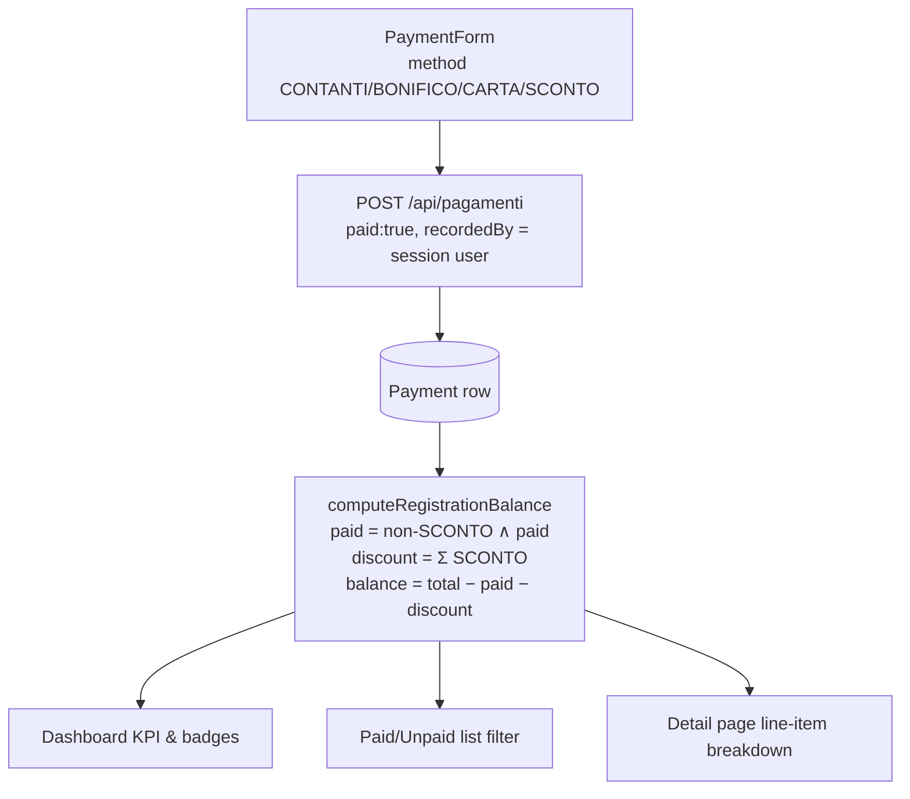
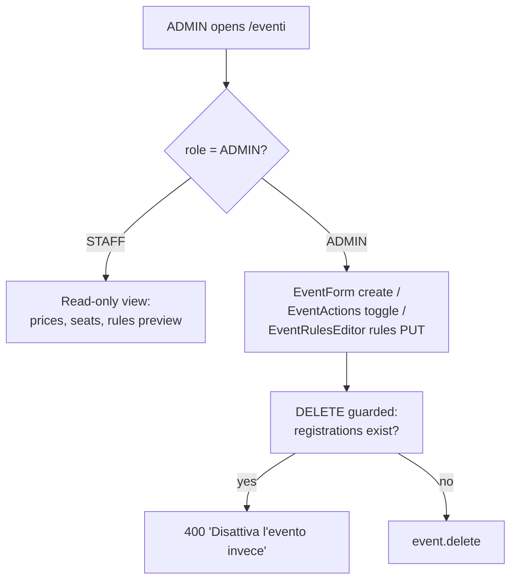
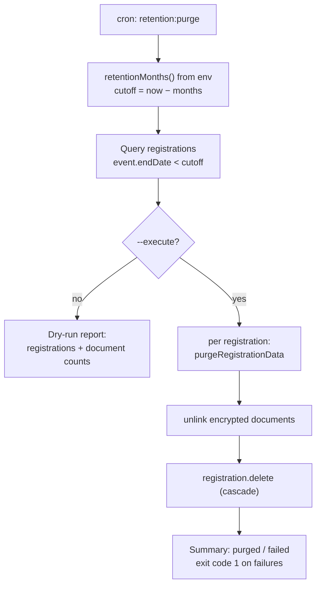

# Core Workflows — Camp CRM

**Version:** 1.0 · **Generated:** 2026-09-11

---

## 1. Workflow overview

### 1.1 How work moves through this system

Picture a small registrar's office. The **front window** is the public enrollment form — open to anyone, day and night, no appointment (account) needed. Behind it stands a clerk who checks every application twice: once quickly at the counter (pre-checks for fast feedback), and once more with the ledger open before writing it down (the in-transaction capacity re-check). The **filing cabinet** is SQLite plus a locked drawer of encrypted ID documents. The **staff room** is the dashboard, where operators confirm enrollments, record money in the cash log, and attach or replace documents. Finally, a **cleaning crew** (the retention script) visits on a schedule and shreds everything the law says must not be kept any longer.

Four flows carry nearly all the system's value: public enrollment (with its document-upload epilogue), staff document management, payment recording, and background retention. Two more are operational rather than daily: ADMIN event administration and the one-off encryption migration.

### 1.2 The core execution path

Everything the system does lands in the same place — rows in SQLite and envelopes on disk — and everything eventually leaves through the same door, `purgeRegistrationData()`. That symmetry is deliberate: one write path, one delete path, nothing in between to forget.

---

## 2. Primary workflows

### 2.1 Public enrollment (the flagship)

This flow solves the hardest product problem in one gesture: let a parent without an account complete an entire enrollment — including identity documents — while the organization keeps provable consent, enforced capacity, and zero public read access. It is the only flow where an unauthenticated browser writes to the system, which is why it carries the most validation layers.

**Sequence of the write path:**

**Why the two-phase submit?** Registration creation is JSON and atomic; documents are multipart and per-participant. Splitting them keeps the server code simple, and the client bridges the gap by matching created participants to picked files on role+name+birthDate. The failure policy is asymmetric on purpose: a failed *upload* never rolls back the *enrollment* — staff can add documents later, but a lost registration would mean a lost family.

**Stage table:**

| Stage | Actor | Input | Output | Notes |
|---|---|---|---|---|
| Event selection | Browser | `/api/eventi`, `/posti` | Prices + remaining seats | Availability colored green/amber/red in the UI |
| Local validation | Browser | Form state | Fast errors | Mirrors server rules exactly (mime, 10 MB) |
| Enrollment create | Server | JSON body | Registration + participants + token | Capacity re-checked inside the transaction (`registrazioni/route.ts` L78-113) |
| Document uploads | Browser → server | Files + `X-Upload-Token` | Encrypted files + metadata | Best-effort; failures surface but don't roll back |
| Landing | Browser | — | `/grazie` or detail + warning | — |

### 2.2 Staff document management

Once enrolled, documents are staff-managed. The detail page embeds one `DocumentManager` per participant; the endpoint accepts either a session or (still) the capability token, so a parent can finish a failed upload later.

The replace ordering matters: new file and metadata land *before* the old file is deleted, so a crash mid-flow can leave a stale file — never a missing document (`documento/route.ts` L160-166).

### 2.3 Payment recording

Money entry is deliberately boring: one form, one endpoint, always `paid: true`. The interesting behavior is downstream — every screen recomputes the balance from the payment facts, and `SCONTO` rows reduce what's owed without counting as cash received.

### 2.4 Event administration (ADMIN only)

ADMIN creates events with the five-slot price ladder, optional participant limit and rules text; deactivation is the soft path, deletion the hard one — and deletion is refused while registrations exist (`src/app/api/eventi/[id]/route.ts` L56-75; the UI hides the button too, `EventActions.tsx` L41). Every write endpoint begins with `assertRole(await auth(), "ADMIN")`; a STAFF poking the API gets 403.

### 2.5 Retention purge (GDPR storage limitation)

Run by cron, dry-run by default. The script finds registrations whose event ended more than `RETENTION_MONTHS` months ago (default 24) and, in execute mode, deletes each through the same `purgeRegistrationData()` used by the dashboard delete: documents off the disk first (best-effort, never blocking), then the cascade delete of participants and payments.

### 2.6 Encryption migration (one-off, idempotent)

For deployments from the plaintext era: validates the key up front, skips files already carrying the `CCLE` magic, and encrypts the rest via temp-file + rename so each file is all-or-nothing (`scripts/migrate-encrypt-documents.ts`). Failures are logged and counted, never fatal to the run.

---

## 3. Concurrency model

The system runs as a single Node process with asynchronous I/O, and it leans on SQLite's single-writer design instead of fighting it. There are no distributed locks, no optimistic versioning, no queues — because at this scale there is exactly one race worth engineering against: **two families submitting for the last seats at the same time**.

The solution is layered. The enrollment route counts remaining seats *before* starting work (fast 409 for the obviously-too-late), then re-counts *inside* a `prisma.$transaction` immediately before the insert (`src/app/api/registrazioni/route.ts` L78-113). Because SQLite serializes writers, the re-check-and-insert pair cannot interleave with another writer's pair — the check-then-act becomes atomic without any explicit locking. Staff edits that replace participants repeat the identical pattern, with the twist that the registration being edited excludes its own rows from the count (`excludeRegistrationId`, `src/lib/participant-cap.ts` L30) so a family editing from three campers to two doesn't count itself twice.

Everywhere else, concurrency is trivial: JWT sessions avoid per-request DB hits, uploads are buffered files, and reads are server renders. The design principle was "stability over cleverness" — the one place where correctness required machinery got the simplest machinery that provably works.

## 4. Error handling strategy

The error philosophy: **validate early, fail specific, degrade gracefully, never orphan data.**

- **Mirrored validation.** Every rule the browser enforces for UX (mime allowlist, 10 MB cap, mandatory consents, availability) is re-enforced authoritatively on the server. The client copy is a courtesy; the server copy is the law.
- **Precise status codes.** API errors are JSON `{ error }` with meaningful semantics: 400 validation, 401 no session, 403 wrong role or bad token, 404 missing entity, 409 capacity. The Italian messages are user-facing (`"Posti insufficienti: rimangono 2 posti su 45…"`) because parents read them.
- **Graceful degradation in the upload epilogue.** Document upload failures after a successful enrollment never discard the enrollment — the user is redirected to the detail page with a warning, since documents are recoverable and registrations are not.
- **Tolerant deletion.** `deleteDocument()` swallows ENOENT (`src/lib/uploads.ts` L137-148) so cleanup can run against already-clean directories; the purge script continues past per-registration failures and reports a non-zero exit code at the end rather than dying mid-run.
- **Idempotent operations.** The retention purge and the encryption migration can be re-run safely — the former because deletion of nothing is nothing, the latter via the magic-byte check.
- **Explicit failures for secret misconfiguration.** A missing or malformed `DOCUMENT_ENCRYPTION_KEY` throws with instructions instead of falling back to plaintext — the one error the system refuses to hide.

---

## 5. Cross-cutting sequence patterns

Across all flows, the same interaction shape recurs: **Browser → guarded API → pure helper in `src/lib/` → Prisma or filesystem**. Guards come first (session or token), helpers do the semantic work, persistence happens last. In sequence terms, every write flow is "authorize → validate → (transaction) → persist → cleanup", and every read flow is "authorize → decrypt/aggregate → render". Once you see that skeleton, each new endpoint in the codebase reads like a variation on a theme you already know.
