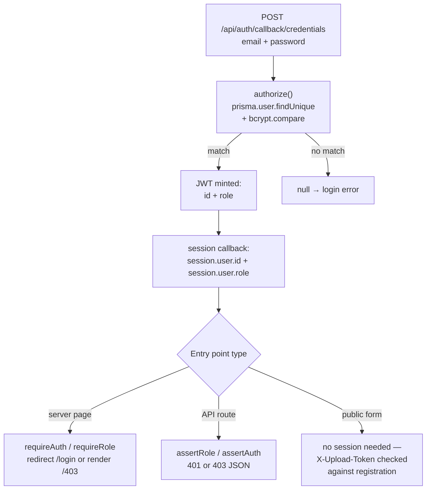

# Authentication & RBAC Domain

**Module paths:** `src/auth.ts`, `src/lib/auth-guard.ts`, `src/types/next-auth.d.ts`, `src/app/login/`, `src/app/403/`, `src/app/api/auth/[...nextauth]/route.ts`
**Generated:** 2026-09-11 · **Importance:** 7/10 (generic, security-critical)

---

## Overview

This module is the bouncer at the door. Camp CRM runs a deliberately tiny two-role world — **ADMIN** and **STAFF** — and this module makes that distinction real at every entry point: pages redirect, APIs return JSON errors, and the role itself rides inside a signed JWT so protecting an endpoint costs one line and zero database queries.

Credentials are email + bcrypt-hashed password against the `User` table. There is no sign-up flow, no password reset, no OAuth — staff accounts come from the seed script or direct insertion, which is the right amount of ceremony for a tool with a handful of trusted operators. The module's real design contribution is its shape: a clean split between **render-time guards** (`requireAuth`/`requireRole` redirect browsers to `/login` or render `/403`) and **request-time guards** (`assertRole`/`assertAuth` return ready-made 401/403 JSON responses), so every page's and every handler's first line reads like a declaration of who may enter.

---

## Core capabilities

1. **Credentials authentication** — NextAuth v5 `Credentials` provider (`src/auth.ts`): looks up the user by email, `bcrypt.compare` against the stored hash (cost 12 at hashing time, `prisma/seed.ts` L24), returns `{ id, name, email, role }` on success. JWT session strategy, custom sign-in page `/login`, `trustHost: true` for containerized deployment.
2. **Role propagation** — the `jwt` callback copies `user.role` into the token; the `session` callback copies `token.id`/`token.role` into `session.user` (`src/auth.ts` L36-51). `src/types/next-auth.d.ts` augments the Session/JWT interfaces so `session.user.role` is a compile-time `"ADMIN" | "STAFF"` everywhere in the codebase.
3. **Page guards** — `requireAuth()` (`src/lib/auth-guard.ts` L10) redirects anonymous visitors to `/login`; `requireRole(...roles)` (L23) additionally renders `/403` when the role doesn't match. Every server page uses them; `eventi/page.tsx` (L7-9) also derives `isAdmin` from the session to hide admin-only UI.
4. **API guards** — `assertRole(session, ...roles)` / `assertAuth(session)` (auth-guard.ts L43-69) return a sendable `NextResponse` (401 unauthenticated / 403 unauthorized) or `null` when authorized, enabling the idiomatic one-liner `if (unauthorized) return unauthorized;`.
5. **Session-aware chrome** — `Navbar.tsx` shows staff links (Iscrizioni, Pagamenti, Eventi) only when a session exists; the home page splits between public landing and staff dashboard based on `auth()`.

---

## Key components

Four small files carry the entire security model; the table shows who does what and why each exists separately.

| Component | File path | Core responsibility |
|---|---|---|
| NextAuth config | `src/auth.ts` | Credentials provider, bcrypt verify, JWT strategy, role-carrying callbacks, custom pages |
| Handler route | `src/app/api/auth/[...nextauth]/route.ts` | GET/POST passthrough of Auth.js `handlers` |
| Redirect guards | `src/lib/auth-guard.ts` (`requireAuth` L10, `requireRole` L23) | Server-component entry checks that navigate browsers |
| JSON guards | `src/lib/auth-guard.ts` (`assertRole` L43, `assertAuth` L60) | Route-handler entry checks that return 401/403 responses |
| Role types | `src/types/next-auth.d.ts` | `Role` union + Session/JWT module augmentation |
| `/login` page | `src/app/login/page.tsx` | Client form calling `signIn("credentials", { redirect: false })` with inline error |
| `/403` page | `src/app/403/page.tsx` | "Riservato agli amministratori" explanation for blocked renders |

---

## Internal data flow

---

## The permission matrix this module enforces

Reading any handler's first line tells you its policy; the matrix below is the sum of those lines across the codebase.

| Action | ADMIN | STAFF | Public (token) |
|---|---|---|---|
| Enroll (`POST /api/registrazioni`) | ✔ | ✔ | ✔ (by design) |
| Upload documents | ✔ | ✔ | ✔ with valid `X-Upload-Token` |
| Read registrations / payments / documents | ✔ | ✔ | ✖ |
| Edit registrations, record payments, delete documents | ✔ | ✔ | ✖ |
| Create / update / delete events, edit rules & pricing | ✔ | ✖ (403 on API, read-only UI) | ✖ |

---

## Key interfaces & extension points

- **New roles**: extend the `Role` union, seed the user, and pass the role to existing guards — every check is role-list based, so a third role composes without new machinery.
- **OAuth / SSO**: Auth.js supports adding providers beside Credentials without touching a single guard.
- **Session hardening**: token revocation or re-issue-on-role-change would slot into the `jwt` callback.

---

## Interaction with other modules

| Interacting module | Direction | Interface | Notes |
|---|---|---|---|
| All pages | depended on | `requireAuth()`, `requireRole()` | Every non-public server component starts here |
| All API routes | depended on | `assertRole()`, `assertAuth()`, or inline `auth()` | One-line policy declarations |
| Document Handling | cooperates | absence of session → token path | The bouncer and the doorman agree on who may pass |
| Ops & Deployment | depends on | `AUTH_SECRET` env, seeded `User` rows | No accounts, no access |

---

## Cross-module collaboration scenarios

**In every staff flow**, this module runs first: the detail page, the payments endpoint and the events admin all begin with a guard call — the security posture is literally the first line of every file.

**In "Public enrollment"**, it plays the *absent landlord*: its controls deliberately do not apply, and the only key that works is the registration's own capability token — a boundary the document module polices with constant-time comparison.

**In "Event administration"**, it is the *star*: the ADMIN/STAFF split is the feature, and the module's `assertRole(..., "ADMIN")` is what makes a STAFF's forged request a clean 403 instead of a data change.

---

## Performance considerations

JWT sessions mean zero DB round-trips for authorization after login (only the initial `authorize` touches the database). bcrypt cost 12 trades ~100 ms of CPU per login for brute-force resistance — invisible at a handful of logins per day.

## Implementation highlights

- **Guards as one-liners**: the `NextResponse | null` return convention turns every protected handler's first three lines into readable policy text.
- **Type-level role safety**: augmenting `next-auth`'s Session/JWT means `"ADMIN" | "STAFF"` is enforced by the compiler, not by stringly-typed comparisons scattered around.
- **Honest limits**: role changes take effect at next sign-in (the role is frozen into the JWT), and there is no token revocation list — documented trade-offs acceptable for a tiny trusted staff, worth revisiting if the team grows.
