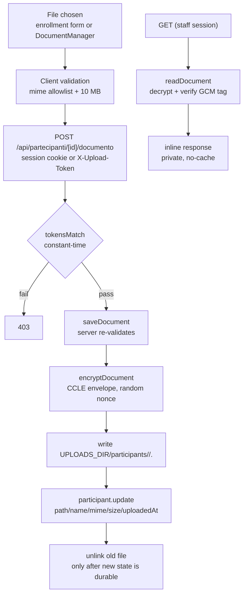

# Document Handling Domain

**Module paths:** `src/app/api/partecipanti/[id]/documento/route.ts`, `src/lib/uploads.ts`, `src/lib/document-crypto.ts`, `src/lib/uploads-client.ts`
**Generated:** 2026-09-11 · **Importance:** 8/10 (core, security-critical)

---

## Overview

This module is the camp's digital filing cabinet for identity documents — and the part of the system with the strictest security posture. Parents upload scans or photos of ID cards during enrollment; staff view, replace or remove them from the registration detail page. Because an identity document is exactly the data a breach turns into identity fraud, every file is encrypted *inside the application* before it touches a disk: neither a stolen server, a stolen backup, nor a leaked Docker volume yields anything readable without the key — and the key deliberately lives outside the data volume.

In roughly four small files the module answers the three questions that make document storage hard: **who may upload** (an authenticated staff session *or* the registration's capability token, compared in constant time), **what may be uploaded** (a mime allowlist and a 10 MB cap, enforced on both sides of the network), and **where files live** (`UPLOADS_DIR/participants/<participantId>/<uuid>.<ext>`, with server-generated names and traversal-proof path resolution). Everything else — the versioned envelope format, the GCM tamper detection, the fail-closed key handling — follows from taking those three answers seriously.

---

## Core capabilities

1. **Validated, encrypted persistence** — `saveDocument()` (`src/lib/uploads.ts` L73): allowlist `image/jpeg|png|webp|application/pdf`, non-empty, ≤ `MAX_UPLOAD_BYTES` (10 MB); the stored name is a random UUID with the extension derived from the *server-observed* mime, never from the client's filename.
2. **Envelope encryption at rest** — `encryptDocument()` / `decryptDocument()` (`src/lib/document-crypto.ts` L83 / L104): binary envelope = magic `"CCLE"` (4B) + version (1B) + keyId (1B) + random nonce (12B) + GCM auth tag (16B) + ciphertext. AES-GCM means a wrong key or a tampered byte fails decryption loudly instead of producing silent garbage.
3. **Fail-closed key management** — `requireDocumentKey()` (L42) validates that `DOCUMENT_ENCRYPTION_KEY` decodes to exactly 32 bytes and caches the result; a missing key throws with instructions, so an upload is *never* silently written in plaintext.
4. **Dual authorization with timing safety** — POST accepts a session (staff) or the `X-Upload-Token` header; `tokensMatch()` (route L19-27) compares with `timingSafeEqual`, including a dummy comparison on length mismatch so response timing doesn't leak the expected token's length. The token replaced an earlier 10-minute upload window (comment at L82-86) — capabilities don't punish slow parents.
5. **Safe serving and cleanup** — `GET` decrypts and streams inline with `Cache-Control: private, no-cache` (L32-86); `DELETE` nulls metadata and unlinks the file (L175-208); `documentAbsolutePath()` (`uploads.ts` L121) rejects `/`, `\` and `..`; `deleteDocument()` (L137) treats ENOENT as success so cleanup is idempotent.

---

## Key components

Each component owns one stage of the byte's journey; the route handler is only a coordinator, which is why the crypto and storage logic are reusable from scripts (migration, retention) without dragging HTTP along.

| Component | File path | Core responsibility |
|---|---|---|
| Route `GET` / `POST` / `DELETE` | `src/app/api/partecipanti/[id]/documento/route.ts` (L32 / L88 / L175) | Serving decrypted bytes; upload/replace with token-or-session auth; removal |
| `saveDocument` | `src/lib/uploads.ts` (L73) | Validation, UUID naming, per-participant folder, encrypted write, metadata return |
| `readDocument` / `deleteDocument` / `documentAbsolutePath` / `getUploadsDir` | `src/lib/uploads.ts` (L150 / L137 / L121 / L11) | Decrypt-and-return, tolerant unlink, traversal guard, lazily-resolved root |
| `encryptDocument` / `decryptDocument` / `requireDocumentKey` / `isEncryptedEnvelope` | `src/lib/document-crypto.ts` (L83 / L104 / L42 / L75) | Envelope crypto, key validation/caching, magic-byte detection |
| `uploadFile` | `src/lib/uploads-client.ts` (L21) | XHR upload with `upload.onprogress` (fetch can't report upload progress), custom headers for the token |
| `DocumentManager` | `src/app/registrazioni/[id]/DocumentManager.tsx` | Staff UI: view / replace / delete with validation and progress |
| `UploadProgress`, `Spinner` | `src/components/UploadProgress.tsx` | Shared progress bar and spinner used by both upload surfaces |

---

## Internal data flow

**Key steps:**

1. **Replace ordering** (route L160-166): the new file is written and the DB updated *before* the old file is unlinked — a crash can leave a stale orphan file, never a missing document.
2. **Magic bytes as idempotency**: `isEncryptedEnvelope` is what makes the one-off migration safely re-runnable (`scripts/migrate-encrypt-documents.ts` L68-71) — already-encrypted files are skipped by their header, not by bookkeeping.
3. **Metadata vs bytes**: DB stores the *plaintext* size for display and the original filename for download headers; the envelope on disk is 34 bytes larger and its name is a UUID nobody chose.

---

## Key interfaces & extension points

- **Key rotation**: the envelope already carries a version byte and `keyId`; `decryptDocument` fails with an explicit "configure the right key or implement rotation" message on keyId mismatch (`document-crypto.ts` L122-128). Rotation needs a re-encryption script, not a format change.
- **Content pipeline**: virus scanning or image normalization would insert into `saveDocument` before `encryptDocument` — one choke point, all surfaces covered.
- **Alternative stores**: `UPLOADS_DIR` resolution is already lazy and env-driven (`getUploadsDir`, L11); swapping the local filesystem for object storage means reimplementing four small functions.

---

## Interaction with other modules

| Interacting module | Direction | Interface | Notes |
|---|---|---|---|
| Registration Management | depended on | `X-Upload-Token` capability; `purgeRegistrationData()` | The enrollment epilogue uploads via token; deletion flows through the shared purge |
| Auth & RBAC | depends on | `auth()` session | Staff GET/POST/DELETE; the public path substitutes the token |
| Privacy & GDPR | depended on | file deletion via `purgeRegistrationData()` | Retention purge removes the actual bytes, satisfying storage limitation |
| Ops & Deployment | depends on | `UPLOADS_DIR`, `DOCUMENT_ENCRYPTION_KEY` | Bind-mount target and key provisioning are deployment concerns |

---

## Cross-module collaboration scenarios

**In "Public enrollment"**: this module is the *bridge* that lets an unauthenticated parent deliver documents — the registration response hands over the token, and this module alone decides whether an upload without a session is legitimate.

**In "Staff document management"**: it is the *workhorse* — the same endpoint serves inline views (with strict cache headers), atomic-feeling replaces, and clean deletes.

**In "Retention purge" and "Encryption migration"**: as a *library* — both scripts import its functions directly, proving the HTTP layer was never load-bearing for the storage logic.

---

## Performance considerations

Uploads are fully buffered in memory (`file.arrayBuffer()`), bounded by the 10 MB cap — predictable and safe at camp scale. Plaintext exists in RAM only during encrypt/decrypt; disk and backups never see it. `no-cache` on served documents prevents browser and proxy retention of decrypted views.

## Implementation highlights

- **Versioned envelope from day one**: magic + version + keyId cost 6 bytes and make both the migration's idempotency check and future key rotation possible — a small upfront tax that pays for two features.
- **Length-hiding token comparison** (`tokensMatch` L19-27): the dummy `timingSafeEqual(b, b)` on length mismatch is a textbook timing-attack mitigation, present because the token is the *only* thing standing between the internet and a write endpoint.
- **Server-side naming** (`safeExtension` / `mimeToExtension`, uploads.ts L38-56): the client filename is demoted to display metadata; extension and path are derived server-side, eliminating entire classes of path-traversal and double-extension attacks.
