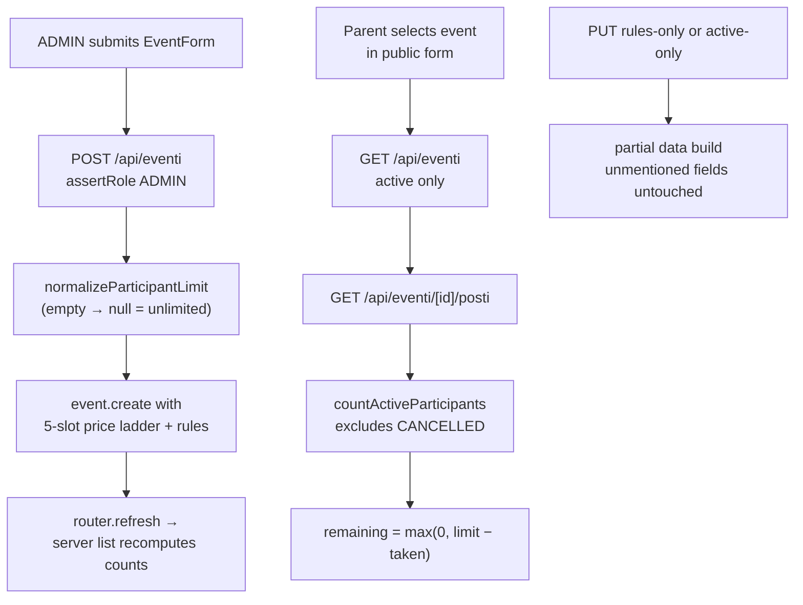

# Event Management Domain

**Module paths:** `src/app/eventi/`, `src/app/api/eventi/`, `src/lib/participant-cap.ts`
**Generated:** 2026-09-11 · **Importance:** 8/10 (core domain)

---

## Overview

Events are the seasonal containers everything else hangs off: a camp session with dates, a location, a five-slot price list, the rules text parents must accept, and — critically — a participant capacity. This module is where the product's RBAC story is most visible: **only ADMIN** creates, edits or deletes events, STAFF sees a read-only page, and the public site consumes just two GET endpoints that expose active events and remaining seats — and nothing else about the administration.

The subtle heart of the module is not CRUD but **capacity semantics**. `Event.participantLimit` counts adults plus campists summed across all *non-cancelled* registrations; cancelling a registration frees its seats; and the three primitives that define this (`normalizeParticipantLimit`, `countActiveParticipants`, `checkCapacity` in `src/lib/participant-cap.ts`) live here and are consumed by the registration module. One definition, three consumers — no seat can be double-counted or silently lost.

---

## Core capabilities

1. **ADMIN-gated lifecycle** — `POST /api/eventi` (`src/app/api/eventi/route.ts` L16) and `PUT`/`DELETE /api/eventi/[id]` (`src/app/api/eventi/[id]/route.ts` L7 / L48) each start with `assertRole(await auth(), "ADMIN")`. `GET` is public and filters `active: true` (L7-14) because the enrollment form is its consumer.
2. **Guarded deletion** — delete returns 400 with the count of linked registrations instead of cascading destruction (L56-75); the UI hides the delete button when registrations exist (`EventActions.tsx` L41). The intended path for retired events is deactivation (`active: false`).
3. **Tiered pricing input** — `EventForm.tsx` collects `priceAdult` plus `priceKid1..priceKid4Plus` (L24-33, L153-200); interpretation (which ordinal pays what) lives in `src/lib/pricing.ts`, keeping money math out of this module.
4. **Capacity primitives** — `normalizeParticipantLimit()` (`participant-cap.ts` L15: empty/invalid/negative → `null` = unlimited, else truncated non-negative int), `countActiveParticipants()` (L30: counts ADULT+KID over non-CANCELLED registrations, optional `excludeRegistrationId`), `checkCapacity()` (L55: returns Italian error strings or `null`).
5. **Rules editing** — `EventRulesEditor.tsx` saves a rules-only partial PUT; the text renders in the public enrollment form above the mandatory rules consent checkbox.

---

## Key components

The split is deliberate: server components hold the data and the role check, client components hold only interaction, and the capacity primitives live in a dependency-free lib file both sides of the system can trust.

| Component | File path | Core responsibility |
|---|---|---|
| `EventiPage` (server) | `src/app/eventi/page.tsx` | List with per-event active-participant counts (recomputed from registrations, L36-45), rules preview, `isAdmin` gating of forms |
| `EventForm` | `src/app/eventi/EventForm.tsx` | Creation form: identity/dates, limit ("vuoto = illimitato"), 5 price slots |
| `EventActions` | `src/app/eventi/EventActions.tsx` | Activate/deactivate toggle; delete only offered when no registrations |
| `EventRulesEditor` | `src/app/eventi/EventRulesEditor.tsx` | Expandable rules textarea; rules-only partial PUT |
| API collection route | `src/app/api/eventi/route.ts` | Public GET (active only); ADMIN POST |
| API item route | `src/app/api/eventi/[id]/route.ts` | ADMIN PUT (partial) and guarded DELETE |
| Availability route | `src/app/api/eventi/[id]/posti/route.ts` (L7) | Public `{ limit, taken, remaining }` for the enrollment form |
| `participant-cap.ts` | `src/lib/participant-cap.ts` | Limit normalization, counting, checking — the shared capacity vocabulary |

---

## Internal data flow

**Key steps:**

1. **Partial update pattern** (`[id]/route.ts` L17-45): `data` is built only from fields present in the body — a rules-only save can never reset prices, an active-toggle can never clear the limit.
2. **No denormalized counters**: the admin list recomputes participant counts from registrations on each render (page.tsx L36-45), so a stored counter can't drift from reality.
3. **Availability endpoint minimalism** (`posti/route.ts`): exposes exactly three numbers, never the underlying registrations — public surface kept as small as the feature allows.

---

## Key interfaces & extension points

- **Per-event policies**: custom document requirements or extra consent texts would extend the `Event` model alongside `rules`, following the same partial-PUT pattern.
- **Pricing evolution**: early-bird windows or date-based pricing slot into `src/lib/pricing.ts` beside `kidPriceByOrdinal`; this module only *stores* prices.
- **Soft deletion formalization**: `active` already implements deactivation; an `archivedAt` would be a small, compatible step.

---

## Interaction with other modules

| Interacting module | Direction | Interface | Notes |
|---|---|---|---|
| Registration Management | depended on | `eventId` FK; `participantLimit`; `countActiveParticipants()`; `checkCapacity()` | Registration is the heaviest consumer of capacity semantics |
| Payments & Pricing | depended on | price fields (`priceAdult`, `priceKid1..4Plus`) | Stored here, interpreted there |
| Auth & RBAC | depends on | `assertRole(..., "ADMIN")`, `requireAuth()` | The clearest ADMIN/STAFF boundary in the product |
| Shared UI | depended on | public GET endpoints | The enrollment form's event picker and availability widget |

---

## Cross-module collaboration scenarios

**In "Public enrollment"**: this module plays the *gatekeeper* — its GET endpoints tell the form which events exist and how many seats remain, and its capacity primitives decide inside the registration transaction whether the family fits.

**In "Event administration"**: it is the *protagonist* — the ADMIN-only write surface where pricing, rules and limits are authored, with deletion refused while any registration still points at the event.

**In "Retention purge"**: as a *reference* — `Event.endDate` is the clock the retention cutoff is measured against.

---

## Performance considerations

The events page aggregates participant counts over all registrations per render — O(registrations), trivial at camp scale. Capacity counting is two indexed COUNT queries per enrollment submission. Both benefit from SQLite's atomic single-writer behavior; no caching layer exists to invalidate because no counts are stored.

## Implementation highlights

- **Capacity as shared vocabulary**: by placing the counting primitives in a pure lib file, the module makes the *semantics* (CANCELLED frees seats, limit counts heads not registrations) testable and reusable — the registration module simply imports the truth instead of re-deriving it.
- **Italian error strings from the domain layer** (`checkCapacity` L55-64): messages like "Posti insufficienti: rimangono N posti su M" are produced where the decision is made, so every consumer shows the same words.
- **Delete-with-a-conscience** (`[id]/route.ts` L56-75): rather than a cryptic FK error, the API returns the exact number of linked registrations and suggests deactivation — an API message written for humans.
