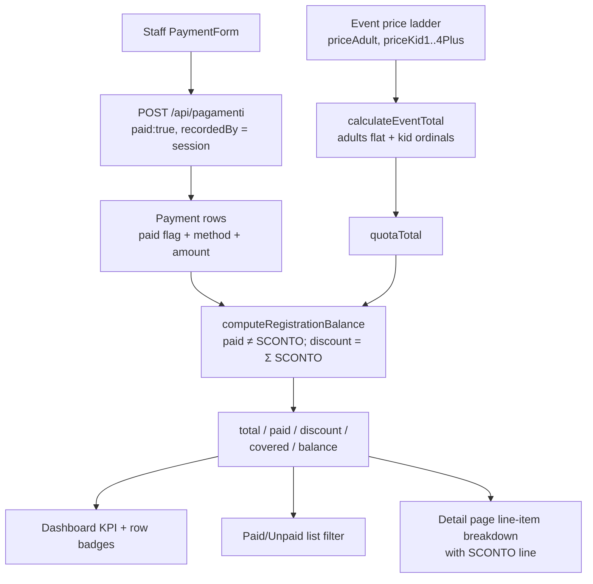

# Payments & Pricing Domain

**Module paths:** `src/app/pagamenti/`, `src/app/api/pagamenti/route.ts`, `src/lib/pricing.ts`
**Generated:** 2026-09-11 · **Importance:** 7/10 (core domain)

---

## Overview

Money in Camp CRM is *recorded*, not *processed*: there is no gateway, no checkout, no card charge. Staff type in what actually happened — cash received at the camp gate, a bank transfer, a card payment, or a discount granted — and the system's job is to make the question "does this family still owe anything?" answerable at a glance on every screen, forever consistent.

The module's elegance comes from what it refuses to do. It does not store balances: every dashboard card, list badge and detail breakdown *recomputes* the balance from the event's price ladder and the registration's payment facts through one shared pure function, `computeRegistrationBalance` (`src/lib/pricing.ts` L86). Because there is no stored number, there is no stored number to drift. And it keeps one business-critical subtlety front and center: a `SCONTO` (discount) payment covers its amount toward the quota but is explicitly *not* money received — the balance shrinks while the cash drawer doesn't grow.

The pricing model is a family discount ladder: each event prices adults flat and campers by ordinal position — 1st, 2nd, 3rd, then 4th-and-beyond — so the second sibling costs less than the first and the fourth can be free (`kidPriceByOrdinal`, L22). An example from the source comments: with adult 150 and kids 190/150/100/0, one adult + three campists = 150 + 190 + 150 + 100 = **590**.

---

## Core capabilities

1. **Quota calculation** — `calculateEventTotal(prices, adultCount, kidCount)` (`src/lib/pricing.ts` L37): `adults × priceAdult` plus each kid's ordinal price; `kidPriceByOrdinal` (L22) maps positions 1/2/3 → `priceKid1/2/3` and ≥4 → `priceKid4Plus` (0 = free).
2. **Balance projection** — `computeRegistrationBalance()` (L86) returns `{ total, paid, discount, covered, balance }`: only `paid: true` non-SCONTO rows count as cash; SCONTO amounts sum into `discount`; `balance = total − (paid + discount)`.
3. **Payment recording** — `POST /api/pagamenti` (`src/app/api/pagamenti/route.ts` L20): always writes `paid: true`, method from the fixed set (`CONTANTI`/`BONIFICO`/`CARTA`/`SCONTO`), `recordedBy` bound to the session user — a per-payment audit trail of *who* registered *what*.
4. **Ledger UI** — `/pagamenti` (`src/app/pagamenti/page.tsx`) lists all payments with registration context; `PagamentiFilters.tsx` (279 lines) filters client-side by event, method and free text.
5. **Consistent presentation** — `formatEuro()` (L50) formats via `Intl.NumberFormat("it-IT")`; every euro sign in the product comes from this one function.

---

## Key components

The table below shows how a single pure-math file feeds four different consumers — the reason a change to balance semantics automatically and instantly updates the whole product.

| Component | File path | Core responsibility |
|---|---|---|
| `pricing.ts` | `src/lib/pricing.ts` | Pure money math: ladder pricing, totals, balances, `DISCOUNT_METHOD`, euro formatting — no DB, no framework |
| `POST` / `GET` handlers | `src/app/api/pagamenti/route.ts` (L20 / L5) | Record payments (session-bound `recordedBy`); list with registration + recorder |
| `PagamentiPage` + `PagamentiFilters` | `src/app/pagamenti/page.tsx`, `PagamentiFilters.tsx` | Ledger with serialized rows (dates → ISO strings) and client-side filters |
| `PaymentForm` | `src/app/registrazioni/[id]/PaymentForm.tsx` | Per-registration form; label and button switch to "Sconto" mode with an explicit hint that discounts aren't cash |
| Balance consumers | `src/app/page.tsx` (L39-40, L90-95), `IscrizioniFilters.tsx`, `registrazioni/[id]/page.tsx` (L22-31) | KPI card, paid/unpaid filter, line-item quota breakdown |

---

## Internal data flow

**Key steps:**

1. **Serialization boundary** (`pagamenti/page.tsx` L21-38): server pages map Prisma rows to plain JSON (dates as ISO strings) before handing them to client filter components — `Date` objects don't survive the RSC → client boundary.
2. **One function, four screens**: dashboard (`page.tsx`), registration list (`IscrizioniFilters.tsx` via `registrationAmounts`), and detail page all call the same projection, so a paid/unpaid badge and the detail page's "Saldo" can never disagree.
3. **Discount transparency**: `PaymentForm` changes its amount label, placeholder notes and button text when `SCONTO` is selected, and the detail page renders a dedicated sky-blue discount line — the *accounting* subtlety is surfaced in the *UI*, not buried in the math.

---

## Key interfaces & extension points

- **Deposits and installments**: the `paid` flag and `paymentDate` already support partial tracking; a due-date field or reminder job would extend naturally beside `POST /api/pagamenti`.
- **A real gateway**: a provider integration would add a webhook-confirmed payment path; the pure-function balance needs no change because it already treats rows as facts.
- **Refunds**: a negative-amount or `REFUND` method would slot into the same projection with a one-line change in `computeRegistrationBalance`.

---

## Interaction with other modules

| Interacting module | Direction | Interface | Notes |
|---|---|---|---|
| Registration Management | depended on | participants (for counts), payments (as facts) | Balances are computed per registration |
| Event Management | depends on | price fields on `Event` | Stored by events, interpreted here |
| Auth & RBAC | depends on | `auth()` session | `recordedBy` binds every payment to a staff account |
| Shared UI | depended on | `formatEuro()`, balance badges | Dashboard and navbar-adjacent surfaces |

---

## Cross-module collaboration scenarios

**In "Payment recording"**: this module is the protagonist — one endpoint writes the fact, and every other screen's display updates on the next render because they all derive from the same facts.

**In "Public enrollment"**: as a *downstream consumer* — the quota a family will owe is computed from the event's ladder the moment the detail page renders, using the participants the enrollment created.

**In "Staff list workflows"**: as the *filter engine* — the paid/unpaid list filter is literally `balance > 0`, computed by the same function the detail page shows.

---

## Performance considerations

Balances are recomputed per row per render from already-fetched includes — pure arithmetic over in-memory arrays, microseconds at camp scale. The ledger loads all payments per visit, mirroring the registration module's "simple and correct" trade-off.

## Implementation highlights

- **No stored balances, ever**: the module's central decision. Any drift bug class involving cached money is structurally impossible.
- **`DISCOUNT_METHOD` as a first-class citizen** (L58): one exported constant drives the API's semantics, the form's copy, the detail page's color coding and the projection's math — a single concept, consistently spelled.
- **Recorded-by audit trail**: `recordedBy → User` on every payment gives the "who entered this?" answer for free, a compliance-friendly default that costs one join.
- **Honest legacy**: the dashboard's "Pagamenti in Sospeso" KPI counts `paid: false` rows even though the write path always sets `true` — a vestige of the earlier pending-payment model, harmless and visibly documented in code rather than silently removed.
