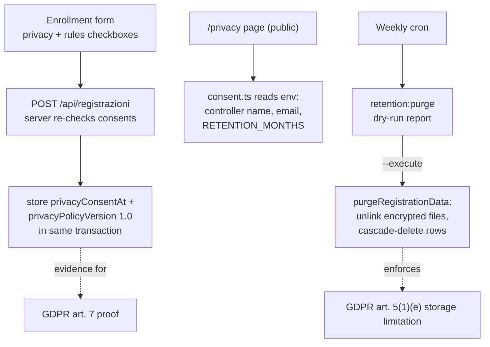

# Privacy & GDPR Domain

**Module paths:** `src/lib/consent.ts`, `src/app/privacy/page.tsx`, consent fields in `prisma/schema.prisma`, `scripts/purge-expired-registrations.ts`
**Generated:** 2026-09-11 · **Importance:** 6/10 (supporting domain)

---

## Overview

This module is the compliance layer — the reason an inspector or a worried parent can be shown *what* was consented, *when*, and against *which version* of the privacy notice, plus the guarantee that data eventually disappears. A camp processing Italian/EU families' personal data, including identity document copies, carries GDPR obligations that paper workflows silently violate; Camp CRM embeds four mechanisms directly into the data model and scripts instead of bolting on a consent platform.

The design philosophy is **"make the compliant path the default path."** Consents are mandatory at enrollment (server-checked, not just checkbox-UX), the policy version is stamped from a single constant so the notice and the records can never disagree, the retention script is dry-run-first so a typo can't destroy a season of data, and deletion always removes files as well as rows. None of this requires discipline from operators — the system simply doesn't offer the non-compliant option.

---

## Core capabilities

1. **Single-source policy version** — `CURRENT_PRIVACY_POLICY_VERSION` (`src/lib/consent.ts` L6) is referenced by the `/privacy` page *and* stamped onto every consent; the README instructs incrementing it whenever the notice changes substantially, which is exactly the art. 7 proof-of-consent requirement.
2. **Consent provenance** — `privacyConsent` / `rulesConsent` flags plus `privacyConsentAt` (timestamp) and `privacyPolicyVersion` (schema L63-71), written in the same enrollment transaction as the rows they attest (`src/app/api/registrazioni/route.ts` L93-98).
3. **Configurable notice facts** — `dataControllerName()`, `dataControllerEmail()`, `retentionMonths()` (`consent.ts` L12-27) read environment variables with safe fallbacks; the public art. 13 notice (`src/app/privacy/page.tsx`) renders seven sections — controller, data categories (including the fact that documents are stored *encrypted*), purposes and legal bases, retention period, recipients, data-subject rights, complaint authority — all parameterized from those helpers.
4. **Retention enforcement** — `scripts/purge-expired-registrations.ts`: selects registrations whose `event.endDate` is older than `RETENTION_MONTHS` (default 24); dry-run by default with a full report; `--execute` deletes through `purgeRegistrationData()` (documents off disk + cascade rows), idempotent, exit code 1 on partial failures. Designed for a weekly cron (README shows the crontab line).
5. **Delete means delete** — dashboard deletion and the retention script share `purgeRegistrationData()` (`src/lib/registration-cleanup.ts`), so "no readable-orphan files" is enforced by construction in both paths.

---

## Key components

The module is small on purpose: one constants file, one public page, one script — each independently readable, none hiding behavior behind framework magic.

| Component | File path | Core responsibility |
|---|---|---|
| `consent.ts` | `src/lib/consent.ts` | Policy version constant; retention months, controller identity, controller email from env with fallbacks |
| `/privacy` page | `src/app/privacy/page.tsx` | Public art. 13 notice (reachable without login, linked from the enrollment form) |
| Consent columns | `prisma/schema.prisma` (L63-71) | Flags + timestamp + policy version on `Registration` |
| Retention script | `scripts/purge-expired-registrations.ts` | Cutoff computation, dry-run report, executed purge via shared cleanup |
| `purgeRegistrationData` | `src/lib/registration-cleanup.ts` (L12) | The single deep-delete primitive (files first, rows second) |

---

## Internal data flow

---

## Key interfaces & extension points

- **Consent history**: upgrading the two flags to a `ConsentEvent` table would turn "latest stamp" into a full audit trail, reusing the same enrollment transaction point.
- **Data-subject tooling**: an export (art. 20) feature could reuse the exact `include` graphs the detail pages already query; an erasure workflow (art. 17) is `purgeRegistrationData` behind a UI button.
- **Notice localization**: `consent.ts` is the only place controller facts live; additional languages or a versioned notice archive extend from there.

---

## Interaction with other modules

| Interacting module | Direction | Interface | Notes |
|---|---|---|---|
| Registration Management | depended on | `CURRENT_PRIVACY_POLICY_VERSION`, consent columns | Enrollment stamps provenance; list/detail render consent badges |
| Document Handling | depended on | `purgeRegistrationData()` | Retention removes the actual encrypted bytes, not just metadata |
| Ops & Deployment | depends on | `RETENTION_MONTHS`, `DATA_CONTROLLER_*` env, cron | Compliance parameters are deployment configuration |
| Auth & RBAC | indirect | — | The notice page is deliberately public; everything else behind session |

---

## Cross-module collaboration scenarios

**In "Public enrollment"**: this module is the *notary* — the checkboxes it defines become stamps (`privacyConsentAt`, `privacyPolicyVersion`) written atomically with the registration, and the `/privacy` page is the document the checkbox points at.

**In "Retention purge"**: it is the *clock and the gavel* — `retentionMonths()` defines when data is expired, and the script's execute mode is the lawful deletion.

**In "Staff document management"**: as a *framing device* — the notice's claim that documents are stored encrypted is true because the Document module enforces it; the modules never call each other, but the compliance statement depends on the other's guarantee.

---

## Performance considerations

The module adds one timestamp and two strings per registration — negligible. The purge script runs off-peak by cron and processes registrations sequentially; each failed deletion is logged and counted rather than aborting the run, with a non-zero exit code so cron mail or monitoring surfaces partial failures.

## Implementation highlights

- **Version stamped at consent time, not read time**: proving consent means showing the *version the user saw*; storing the constant at enrollment is what makes that provable years later.
- **Dry-run-first operations**: the purge script's default mode prints exactly what it would delete (registration IDs, event names, document counts) — the GDPR deletion path is automated *and* rehearsed.
- **Compliance copy in the data model**: the `/privacy` notice states documents are "conservati cifrati" — a claim that holds because `saveDocument` cannot write plaintext when the key is configured, and refuses to run at all when it isn't.
- **Known gaps, honestly documented** (README): health notes in `Participant.notes` may be art. 9 special-category data without a dedicated legal basis; there is no audit log (arts. 5(2), 30, 32) and no self-service export/erasure — the module's own docs treat these as a roadmap, not secrets.
