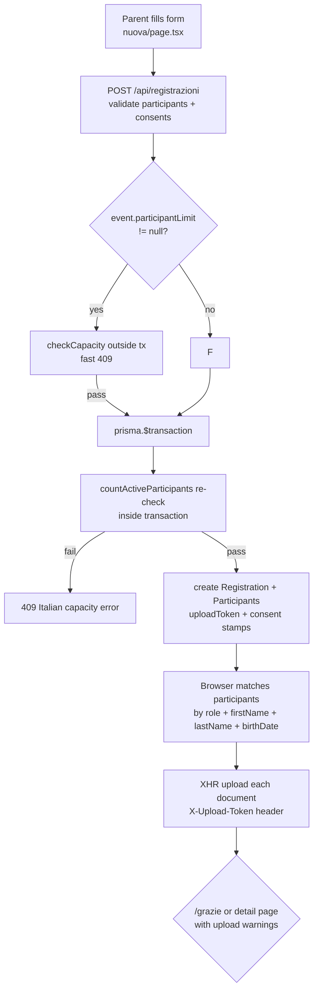

# Registration Management Domain

**Module paths:** `src/app/registrazioni/`, `src/app/api/registrazioni/`, `src/lib/registration-cleanup.ts`
**Generated:** 2026-09-11 · **Importance:** 9/10 (core domain)

---

## Overview

Registration Management is the reason Camp CRM exists. Every other module — events, documents, payments — orbits the `Registration` aggregate, which captures the social contract of enrollment: who is signing (the *sottoscritto*), who is coming (participants), what was agreed to (consents, with timestamps and a policy version), and how identity documents can reach the staff without anyone creating an account (the `uploadToken` capability).

The module spans four faces of the same data. A public face: a 922-line enrollment form (`src/app/registrazioni/nuova/page.tsx`) that a parent fills on a phone. A staff face: a filterable list (`IscrzioniFilters`/`IscrizioniFilters.tsx`) and a detail page (`registrazioni/[id]/page.tsx`) where status changes, participant edits and payments happen. A machine face: four REST endpoints under `src/app/api/registrazioni/`. And a janitorial face: `purgeRegistrationData()` (`src/lib/registration-cleanup.ts`), the shared deep-delete used by both the dashboard and the GDPR retention script.

Its defining design tension: **creation is public, everything else is not.** The module resolves it by making creation a heavily-validated unauthenticated write and handing the creator a one-time capability token for the only public follow-up action.

---

## Core capabilities

1. **Public enrollment with in-transaction capacity control** — `POST /api/registrazioni` (`src/app/api/registrazioni/route.ts` L36) validates participants and consents server-side, pre-checks capacity for a fast 409, then re-checks it *inside* `prisma.$transaction` (L78-113) before creating the registration, its participants, the consent stamps (`privacyConsentAt`, `privacyPolicyVersion` from `CURRENT_PRIVACY_POLICY_VERSION`, `src/lib/consent.ts` L6) and a 256-bit hex `uploadToken` (`randomBytes(32)`, L110).
2. **Status lifecycle** — `PENDING → CONFIRMED / CANCELLED` via partial PUT. `StatusForm.tsx` (`src/app/registrazioni/[id]/StatusForm.tsx` L12) sends status-only bodies; the partial-update handler (L48-71) guarantees nothing else is touched. A CANCELLED registration frees its capacity seats (counting excludes it).
3. **Participant sync-on-replace** — when a PUT body includes `participants`, rows are fully replaced (`deleteMany` + `create`) with an in-transaction capacity re-check that excludes the registration being edited, so editing can't collide with itself (`src/app/api/registrazioni/[id]/route.ts` L117-146).
4. **Deep delete without orphans** — `DELETE /api/registrazioni/[id]` (L157) delegates to `purgeRegistrationData()` (`src/lib/registration-cleanup.ts` L12): document files removed from disk first (best-effort), then the Prisma cascade delete of participants and payments.
5. **Staff productivity UI** — `IscrizioniFilters.tsx` filters client-side by event, paid/unpaid (derived from the shared balance function) and free text across all names; the detail page renders a line-by-line quota breakdown using `kidPriceByOrdinal`.

---

## Key components

These components divide the work between "what the parent sees", "what the server enforces" and "what the janitor cleans up" — keeping each concern in a file you can read on its own.

| Component | File path | Core responsibility |
|---|---|---|
| `NuovaIscrizionePage` | `src/app/registrazioni/nuova/page.tsx` (L65) | Public form: event picker with live prices/availability, subscriber section, adult-attending toggle, dynamic camper rows with mandatory documents, consent checkboxes, two-phase submit (create → upload) with progress |
| `POST` / `GET` handlers | `src/app/api/registrazioni/route.ts` (L36 / L20) | Public enrollment creation; staff-only list with full includes |
| `GET` / `PUT` / `DELETE` handlers | `src/app/api/registrazioni/[id]/route.ts` (L12 / L43 / L157) | Detail fetch; partial update with participant replace + capacity re-check; deep delete |
| `purgeRegistrationData` | `src/lib/registration-cleanup.ts` (L12) | Documents-off-disk-then-cascade-delete, shared with the retention script |
| `IscrizioniFilters` | `src/app/registrazioni/IscrizioniFilters.tsx` | Client-side table (desktop) + cards (mobile), event/paid/text filters, per-row balance |
| `StatusForm` | `src/app/registrazioni/[id]/StatusForm.tsx` | Three-way status switcher writing minimal PUT bodies |

---

## Internal data flow

**Key steps:**

1. **Two-phase submit** (`nuova/page.tsx` L290-340): the JSON create returns participant IDs; the browser then uploads each picked file to the matching participant's endpoint. Matching by role+name+birthDate keeps the wire contract free of client-generated IDs.
2. **Consent stamps in the same transaction** (route.ts L93-98): `privacyConsentAt` and `privacyPolicyVersion` are written atomically with the rows they attest — there is never a consented row without provenance.
3. **Capability handoff** (L110): the token exists only in the creation response; the server stores its hash-worthy original for later constant-time comparison at the document endpoint.

---

## Key interfaces & extension points

- **New consent kinds**: the pattern established by `rulesConsent` (column + checkbox + server check + stamp) composes for additional consent types.
- **Notification hook**: the moment after successful creation (before redirect) is where an email/notification integration would slot in; today `/grazie` promises an email that isn't sent (a README-documented gap).
- **Import/migration**: `purgeRegistrationData` being the only delete path makes a future merge/anonymization tool straightforward to add beside it.

---

## Interaction with other modules

| Interacting module | Direction | Interface | Notes |
|---|---|---|---|
| Event Management | depends on | `eventId` FK, `participantLimit`, `countActiveParticipants()`, `checkCapacity()` | Capacity semantics live in the event module; registration consumes them twice per write |
| Payments & Pricing | depends on | `calculateEventTotal()`, `computeRegistrationBalance()` | Detail page and list render money projections computed from registration participants |
| Document Handling | depends on | `X-Upload-Token` protocol, `purgeRegistrationData()` | Upload epilogue after creation; file cleanup on delete |
| Privacy & GDPR | depends on | `CURRENT_PRIVACY_POLICY_VERSION`, `privacyConsentAt` | Stamps provenance at creation; purge script reuses this module's delete path |
| Auth & RBAC | depends on | `auth()` session | GET/PUT/DELETE require a session; POST deliberately does not |

---

## Cross-module collaboration scenarios

**In "Public enrollment"**: this module is the highway. It calls Event Management's capacity primitives twice (pre-check and in-transaction), stamps consent metadata from the Privacy module, mints the capability token consumed by Document Handling, and finishes by redirecting to `/grazie` (Shared UI).

**In "Retention purge"**: this module plays the *supplier* role — its `purgeRegistrationData` is the entire deletion engine the Privacy module's cron script drives.

**In "Payment recording"**: as the *host* — payments attach to a registration, and this module's detail page renders the resulting balance using the Payments module's pure functions.

---

## Performance considerations

List pages load **all** registrations with `event`, `participants` and `payments` included (`registrazioni/page.tsx` L11-24) and filter client-side — simple and correct for hundreds of rows, a ceiling at tens of thousands. Enrollment does two capacity COUNT queries per submission (pre-check + in-transaction), negligible at camp scale. The detail page aggregates payments with their recorders in one Prisma query.

## Implementation highlights

- **Partial-update discipline** ([id]/route.ts L48-71): building `data` only from present body fields is what makes status-only saves safe; the same discipline appears in the events module.
- **Double capacity check** (route.ts L74-113): the pre-check exists purely to fail fast; the in-transaction re-check is the correctness guarantee — SQLite's single-writer serialization makes the pair atomic.
- **Token as capability, not password** (schema comment on `uploadToken`): 256 bits of entropy, unique-indexed, compared with `timingSafeEqual` at the document endpoint — replacing an earlier 10-minute-window design that punished slow uploaders.
