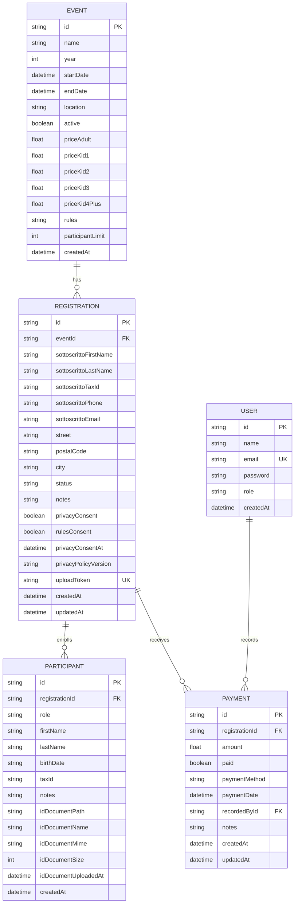

# Database Overview — Camp CRM

**Version:** 1.0 · **Generated:** 2026-09-11 · **Engine:** SQLite (file) via Prisma 7 (`prisma/schema.prisma`, 8 migrations)

## Why this database looks the way it does

Camp CRM's schema is a textbook small aggregate model: five tables, one clear root (`Registration`), cascade deletes everywhere downstream of it, and *no stored computed values* — balances, seat counts and quota totals are always derived at read time from these rows. Two columns deserve special attention because they encode the system's two hardest requirements: `Registration.uploadToken` (the capability that lets an account-less parent upload documents) and the consent trio `privacyConsent` / `privacyConsentAt` / `privacyPolicyVersion` (the GDPR proof of what was agreed and when). Everything is a `String` id (cuid) and enums are plain strings validated in application code — a Prisma-on-SQLite idiom, since SQLite has no native enum type.

## Statistics

| Kind | Count |
|---|---|
| Tables (models) | 5 — `User`, `Event`, `Registration`, `Participant`, `Payment` |
| Views / stored procedures | 0 |
| Migrations | 8 (`prisma/migrations/`, 2026-05-19 → 2026-07-27) |
| Unique constraints | 2 — `User.email`, `Registration.uploadToken` |
| Cascade deletes | Registration → Participants, Registration → Payments, Event → Registrations (blocked at API level when non-empty) |

Migration history tells the product's story in miniature: `init` → `add_id_document` → `add_participants` → `add_event_pricing` (the sibling discount ladder) → `add_notes_rules_consent` → `add_upload_token` (public document uploads) → `add_consent_record` (art. 7 provenance) → `add_event_participant_limit` (overbooking protection).

## Entity-relationship diagram

Reading the diagram: the document bytes are deliberately *not* in the diagram — `PARTICIPANT.idDocument*` columns are metadata pointing at encrypted files under `UPLOADS_DIR/participants/<id>/`, a split that trades transactional simplicity for backup-friendly storage.

## Table details

### User — staff accounts (`prisma/schema.prisma` L10)
| Column | Type | Constraints | Meaning |
|---|---|---|---|
| id | String | PK, cuid | |
| name | String | | display name in the navbar and payment ledger |
| email | String | **unique** | login identifier |
| password | String | | bcrypt hash, cost 12 |
| role | String | default `"STAFF"` | `"ADMIN"` \| `"STAFF"` — validated in app code |
| createdAt | DateTime | default now | |

One soft dependency: `Payment.recordedBy` references a User *without* cascade — deleting a staff member with recorded payments is intentionally hard.

### Event — the camp session (L20)
| Column | Type | Constraints | Meaning |
|---|---|---|---|
| id | String | PK | |
| name / year | String / Int | | year drives descending ordering |
| startDate / endDate | DateTime | | `endDate` is the clock retention is measured against |
| location | String | default `""` | |
| active | Boolean | default true | public event list filters on it; deactivation is the soft-delete |
| priceAdult | Float | default 0 | flat adult price |
| priceKid1 / 2 / 3 / 4Plus | Float | default 0 | sibling ladder — 1st, 2nd, 3rd, 4th-and-beyond camper (0 = free) |
| rules | String | default `""` | camp rules text shown for mandatory acceptance |
| participantLimit | Int? | nullable | `null` = unlimited; counts ADULT+KID across non-cancelled registrations |

### Registration — the aggregate root (L49)
| Column | Type | Constraints | Meaning |
|---|---|---|---|
| id | String | PK | |
| eventId | String | FK → Event, **Cascade** | |
| sottoscrittoFirstName / LastName | String | | the signer (parent/guardian or attending adult) |
| sottoscrittoTaxId | String | | set to `""` by the public POST (kept for staff-created rows) |
| sottoscrittoPhone / Email | String | default `""` | contact channels |
| street / postalCode / city | String | default `""` | address |
| status | String | default `"PENDING"` | `PENDING` \| `CONFIRMED` \| `CANCELLED`; CANCELLED frees capacity seats |
| notes | String | default `""` | free-text remarks |
| privacyConsent | Boolean | default false | mandatory at creation (server-enforced) |
| rulesConsent | Boolean | default false | mandatory at creation |
| privacyConsentAt | DateTime? | | art. 7 proof — when consent was given |
| privacyPolicyVersion | String? | | which notice version was accepted (from `CURRENT_PRIVACY_POLICY_VERSION`) |
| uploadToken | String | **unique** | 256-bit hex capability authorizing public document uploads |
| createdAt / updatedAt | DateTime | default now / @updatedAt | |

### Participant — a person on the enrollment (L88)
| Column | Type | Constraints | Meaning |
|---|---|---|---|
| id | String | PK | doubles as the on-disk document folder name |
| registrationId | String | FK → Registration, **Cascade** | |
| role | String | | `"ADULT"` \| `"KID"` — KID ordinal position among siblings = pricing tier |
| firstName / lastName | String | | |
| birthDate | String | | stored as text in DD/MM/YYYY display format — a pragmatic choice, not a date column |
| taxId | String | default `""` | Italian codice fiscale |
| notes | String | default `""` | allergies etc. (README flags art. 9 special-category risk) |
| idDocumentPath | String? | | generated filename on disk; `null` = no document |
| idDocumentName | String? | | original client filename, display/download only |
| idDocumentMime | String? | | for serving with correct Content-Type |
| idDocumentSize | Int? | | plaintext byte size (envelope on disk is 34 bytes larger) |
| idDocumentUploadedAt | DateTime? | | last upload timestamp |
| createdAt | DateTime | default now | ordering of kids defines pricing ordinals |

### Payment — money facts (L110)
| Column | Type | Constraints | Meaning |
|---|---|---|---|
| id | String | PK | |
| registrationId | String | FK → Registration, **Cascade** | |
| amount | Float | default 0 | euro amount (float is an accepted trade-off at camp scale) |
| paid | Boolean | default false | the write API always sets `true` (see Payments deep-dive) |
| paymentMethod | String | default `"CONTANTI"` | `CONTANTI` \| `BONIFICO` \| `CARTA` \| `SCONTO` — SCONTO is a discount, not cash |
| paymentDate | DateTime? | | optional effective date (may differ from createdAt) |
| recordedById | String | FK → User (no cascade) | who recorded the payment |
| notes | String | default `""` | e.g. "acconto", scholarship reference |
| createdAt / updatedAt | DateTime | | |

## Relationships & invariants

- **Event 1:N Registration** — cascade exists in the schema, but the API refuses event deletion while registrations remain (`src/app/api/eventi/[id]/route.ts` L56-75): the DB permits what the product forbids, and the product layer is the guard users meet.
- **Registration 1:N Participant / Payment** — both cascade; combined with `purgeRegistrationData()` (files first), one delete call empties three tables and the document folder.
- **User 1:N Payment** — recorder attribution without cascade.
- **Capacity invariant** — `count(participants where registration.eventId = E and registration.status ≠ 'CANCELLED') ≤ E.participantLimit`, enforced by `checkCapacity()` re-checked inside the enrollment transaction (`src/lib/participant-cap.ts`, `src/app/api/registrazioni/route.ts` L78-113).
- **Balance invariant** — `balance = quotaTotal − (Σ paid non-SCONTO + Σ SCONTO)`; never stored, always derived (`src/lib/pricing.ts` L86).

## Data lifecycle

- **Creation**: enrollment transaction writes Registration + Participants + consent stamps + token atomically; payments and documents attach afterwards.
- **Mutation**: partial updates only touch provided fields; participant replacement is delete-many + create inside a transaction with its own capacity re-check.
- **Deletion (user-initiated)**: `DELETE /api/registrazioni/[id]` → files unlinked → cascade rows.
- **Deletion (automated)**: retention script selects `event.endDate < now − RETENTION_MONTHS` and reuses the same purge path; dry-run first, idempotent, cron-friendly.
- **Backups**: copy the SQLite file and the uploads directory; the encryption key must be backed up separately — without it the document half of any backup is unreadable by design.
